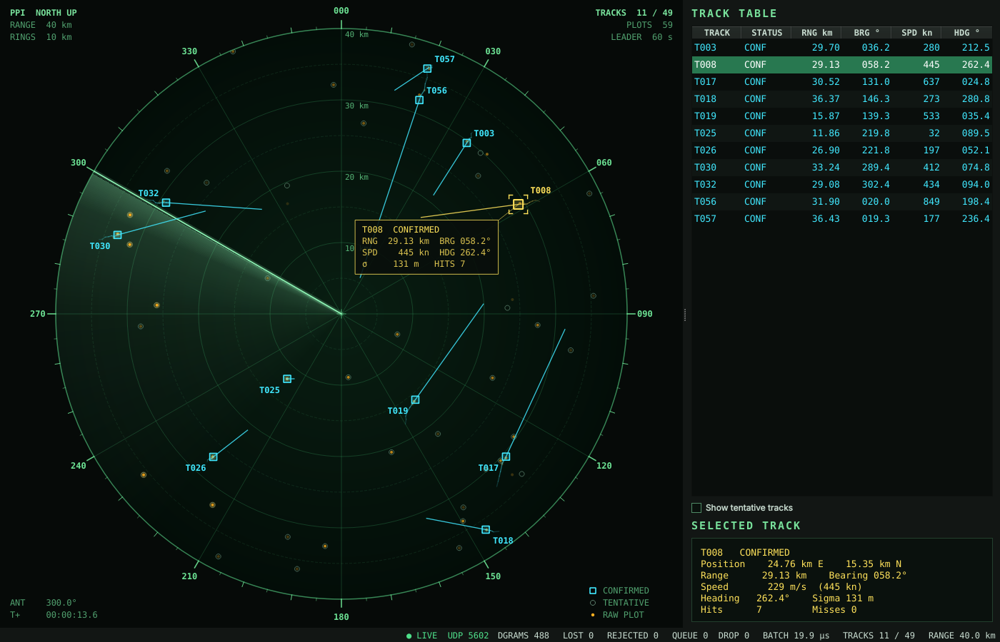
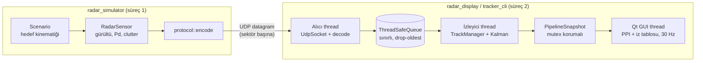

# Radar Target Tracker

[](https://github.com/mustafagulturk/radar-target-tracker/actions/workflows/ci.yml)


Dönen bir gözetleme radarının ürettiği sahte ölçümleri UDP üzerinden alan, bunları çok iş parçacıklı bir hatta işleyen, **Kalman filtresi** ile çoklu hedef izi takibi yapan ve sonucu **Qt** ile klasik bir radar **PPI** (Plan Position Indicator) ekranında gösteren C++17 projesi.

*A C++17 radar target tracking simulator: a rotating-radar model streams noisy plots over UDP, a multithreaded pipeline runs multi-target Kalman tracking with gating and track management, and a Qt PPI display renders the picture. Built with CMake, tested with GoogleTest, checked by GitHub Actions (GCC/Clang, ASan/UBSan, TSan).*



## Öne çıkanlar

- **Gerçekçi sensör modeli:** 30 RPM dönen anten, 5°'lik sektörler, menzil/kerteriz Gauss gürültüsü, tespit olasılığı (Pd) ve Poisson dağılımlı sahte alarm (clutter).
- **İkili UDP protokolü:** Büyük endian, sürümlü, MTU altında kalacak şekilde parçalanan datagramlar; bozuk paketler reddedilir, sıra numarasıyla paket kaybı ölçülür.
- **Çok iş parçacıklı hat:** Ağ alıcısı ve izleyici ayrı thread'lerde; aralarında sınırlı, "en eskiyi at" politikalı thread-safe kuyruk. Ağ I/O'su izleme yüküyle asla bloklanmaz.
- **Kalman filtresi:** 4 durumlu sabit hız modeli, sürekli beyaz gürültü ivme modeli, kutupsal ölçümün Jacobian ile Kartezyen'e dönüştürülmüş kovaryansı, sayısal kararlılık için Joseph formu.
- **İz yönetimi:** Mahalanobis (χ², 2 serbestlik derecesi) kapılama, açgözlü global en yakın komşu (GNN) eşleştirme, M-of-N iz doğrulama, kaçırma sayacına dayalı iz silme. Bir iz yalnızca anten gerçekten o yöne baktığında "kaçırıldı" sayılır.
- **Qt PPI ekranı:** Fosfor izli dönen tarama, menzil halkaları, kerteriz skalası, solan ham plotlar, iz geçmişi, hız vektörü, iz tablosu ve canlı istatistikler.
- **Kalite:** `-Wall -Wextra -Wconversion ... -Werror`, GoogleTest birim + entegrasyon testleri, AddressSanitizer / UndefinedBehaviorSanitizer / ThreadSanitizer CI işleri, clang-format kontrolü.

## Mimari



| Katman | Dosyalar | Sorumluluk |
| --- | --- | --- |
| Matematik | `matrix.hpp`, `coordinates.*` | Sabit boyutlu matrisler (heap yok), kutupsal ↔ Kartezyen, ölçüm kovaryansı |
| Filtre | `kalman_filter.*` | CV modeli tahmin/güncelleme, inovasyon ve Mahalanobis mesafesi |
| İzleme | `track_manager.*` | Kapılama, GNN eşleştirme, iz başlatma / doğrulama / silme |
| İletişim | `protocol.*`, `udp_socket.*` | İkili tel formatı, RAII POSIX UDP soketi |
| Eşzamanlılık | `thread_safe_queue.hpp`, `tracking_pipeline.*` | Üretici/tüketici kuyruğu, iki aşamalı işleme hattı |
| Simülasyon | `sim/*` | Hedef hareketi (koordineli dönüş), radar sensör modeli, senaryolar |
| Uygulamalar | `apps/*` | Simülatör, başsız izleyici, Qt ekranı |

### İzleme algoritması

Her sektör paketi geldiğinde `TrackManager::process`:

1. Tüm izleri paket zamanına **tahmin** eder (`x = F x`, `P = F P Fᵀ + Q`).
2. Her plotu `(r, θ)` → `(x, y)` dönüştürür; kovaryansı `R = J · diag(σr², σθ²) · Jᵀ`.
3. Her iz–plot çifti için inovasyon `y = z − Hx`, `S = HPHᵀ + R`, `d² = yᵀS⁻¹y` hesaplar; `d² ≤ 16` (χ², 2 s.d., ~%99.97) olanlar aday olur.
4. Adayları `d²`'ye göre sıralayıp açgözlü GNN ile birebir eşleştirir; eşleşen izler Joseph formunda **güncellenir**.
5. Taranan sektörde olup eşleşmeyen izlerin kaçırma sayacını artırır; eşiği aşanları siler.
6. Eşleşmeyen plotlardan yeni **geçici** iz başlatır; 3 isabette iz **doğrulanır**.

Süreç gürültüsü sürekli beyaz gürültü ivme modelinden gelir (`q = 300 m²/s³`, 2 s yeniden ziyarette ~1.2 g dönüşü kapı içinde tutacak şekilde ayarlı; bedeli düz uçuşta biraz daha gürültülü kestirimdir, bkz. *Geliştirme fikirleri* → IMM). Bu modelde iki kez `dt/2` tahmin etmek, bir kez `dt` tahmin etmekle aynı kovaryansı verir; izler her sektörde (saniyede 36 kez) tahmin edildiği için bu özellik önemlidir ve testlerle doğrulanır.

### UDP paket formatı

| Ofset | Boyut | Alan |
| --- | --- | --- |
| 0 | 4 | magic `"RDR1"` |
| 4 | 1 | sürüm (1) |
| 5 | 1 | ayrılmış |
| 6 | 2 | plot sayısı N |
| 8 | 4 | sıra numarası |
| 12 | 8 | zaman damgası (µs) |
| 20 | 4 | sektör başlangıcı (float32, rad) |
| 24 | 4 | sektör sonu (float32, rad) |
| 28 | 12·N | plotlar: menzil (m), kerteriz (rad), genlik (dB), float32 |

Tüm alanlar ağ bayt sırasındadır (big-endian). Datagramlar 1400 baytı geçmez; fazla plot olursa aynı sektör birden çok pakete bölünür.

## Derleme

Gereksinimler: Linux, CMake ≥ 3.16, C++17 derleyici (GCC 9+ / Clang 10+), Qt 6 Widgets (yalnızca GUI için). GoogleTest sistemde yoksa CMake otomatik indirir.

```bash
# Ubuntu 22.04 / 24.04
sudo apt install build-essential cmake ninja-build qt6-base-dev libgl1-mesa-dev libgtest-dev

git clone https://github.com/mustafagulturk/radar-target-tracker.git
cd radar-target-tracker
cmake -S . -B build -G Ninja -DCMAKE_BUILD_TYPE=Release
cmake --build build
ctest --test-dir build --output-on-failure
```

| CMake seçeneği | Varsayılan | Açıklama |
| --- | --- | --- |
| `RADAR_BUILD_GUI` | `ON` | Qt ekranını derler (Qt'siz sunucularda `OFF`) |
| `RADAR_BUILD_TESTS` | `ON` | GoogleTest testlerini derler |
| `RADAR_WARNINGS_AS_ERRORS` | `OFF` | Uyarıları hata say (CI'da açık) |
| `RADAR_ENABLE_SANITIZERS` | `OFF` | ASan + UBSan |
| `RADAR_ENABLE_TSAN` | `OFF` | ThreadSanitizer |

## Çalıştırma

İki terminal açın:

```bash
# 1) Radar ekranı (UDP 5005'i dinler)
./build/radar_display

# 2) Radar simülatörü
./build/radar_simulator --targets 6 --clutter 20
```

Ekran olmayan bir makinede GUI yerine başsız izleyiciyi kullanabilirsiniz:

```bash
./build/tracker_cli --port 5005 &
./build/radar_simulator --port 5005 --duration 30
```

Simülatör seçenekleri (`--help`): `--host`, `--port`, `--range`, `--period`, `--targets`, `--pd`, `--clutter`, `--seed`, `--duration`, `--speedup`.

Standart senaryo; kesişen rotalarda iki yolcu uçağı, sürekli 3°/s dönüş yapan bir savaş uçağı, yavaş bir deniz hedefi, hızlı ve düşük RKA'lı bir yaklaşan hedef ve rastgele ek hedeflerden oluşur. Kapsama alanından çıkan hedeflerin yerine yenileri gelir.

## Testler

`tests/` altındaki 94 GoogleTest testi (~1.5 s) şunları kapsar:

- Matris işlemleri ve koordinat dönüşümleri (kuzeyden geçen sektörler dahil)
- Kalman filtresi: CV modeli, kovaryans simetrisi, `Q` birleşim özelliği, gürültülü hedefte yakınsama, kapılama
- Protokol: gidiş-dönüş, bozuk/kısa/fazla bayt/NaN içeren paketlerin reddi, paket bölme
- Thread-safe kuyruk: FIFO, drop-oldest, `close()` ile uyanma, çok üreticili/çok tüketicili stres testi
- İz yönetimi: tek hedef, kesişen hedefler (ID değişimi olmadan), kaybolan hedefin silinmesi, salt clutter, manevra yapan hedef
- Simülasyon: koordineli dönüş kinematiği, tohum ile belirlenimcilik, Pd istatistiği
- Entegrasyon: gerçek UDP soketi üzerinden uçtan uca hat

## Proje yapısı

```
include/radar/        Genel başlıklar (core + sim)
src/core/             Kalman, iz yönetimi, protokol, UDP, işleme hattı
src/sim/              Hedef, sensör ve senaryo modelleri
apps/radar_simulator/ UDP plot üreticisi
apps/tracker_cli/     Başsız izleyici
apps/radar_display/   Qt PPI ekranı
tests/                GoogleTest
.github/workflows/    CI: GCC/Clang × Debug/Release, ASan/UBSan, TSan, clang-format
```

## Geliştirme fikirleri

- Hungarian (Munkres) algoritması ile optimal atama, JPDA
- Manevra eden hedefler için IMM (CV + CT) filtre
- İki noktalı iz başlatma ve iz kalitesi skoru
- Çoklu radar füzyonu ve ASTERIX CAT-048 çıktı formatı

## Lisans

[MIT](LICENSE) © 2026 Mustafa Gulturk
